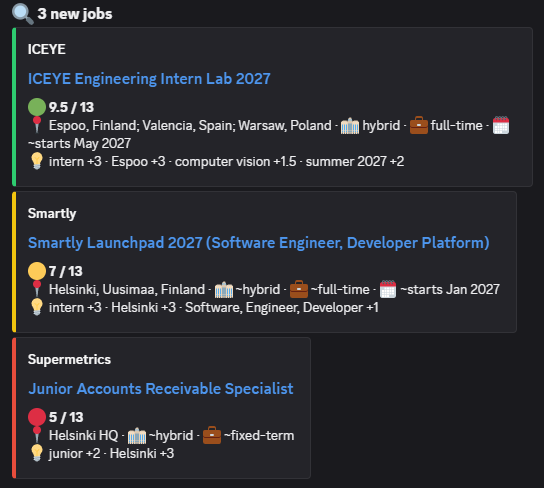

# 🔍 insidejob

[](https://github.com/WainoVanska/insidejob/actions/workflows/ci.yml)

Follow the companies you'd love to work at. insidejob checks their own hiring systems every hour and posts new internships and early-career jobs to your Discord, ranked for you, with the reasons.

Free, open source, no account. Set up in 5 minutes, all in the browser.



## Why

- **Straight from the source.** Jobs come from the company's own hiring system (Greenhouse, Ashby, Workable, Teamtailor, job feeds), often before they reach any job board, and some never do.
- **Your list, not a keyword search.** You pick the companies, so there's no noise from hundreds of employers you don't care about.
- **Ranked for you.** Each job gets a score and a 🟢🟡🔴 colour, with the reasons: `💡 intern +3 · Espoo +3 · graphics +3 · summer 2027 +2`. Senior roles are left out, and jobs asking for years of experience rank lower.
- **Yours.** It runs in your own GitHub copy. Your preferences and job history stay there; there are no ads and no tracking.

**Not a job board.** insidejob only watches the companies you list. To browse everything that's out there, use a job board like [Duunitori](https://duunitori.fi).

## Set up in 5 minutes

You need a GitHub account and a Discord server (your own private one is fine).

1. **Copy this repo:** click **Use this template → Create a new repository**. Private is fine.
2. **Connect Discord:** in your Discord channel open **Edit channel → Integrations → Webhooks → New Webhook → Copy Webhook URL**. In your new repo open **Settings → Secrets and variables → Actions → New repository secret**, name it `DISCORD_WEBHOOK_URL` and paste the URL.
3. **Say what you're looking for:** open [`config.yaml`](config.yaml) in your repo, click the pencil icon and fill in `looking_for` (roles, cities, interests, start date) and `companies`: paste the link of any job ad from each company's careers page. Click **Commit changes**.
   The **Check config** action then runs by itself. Open **Actions → Check config → the latest run** to see your companies, how many jobs match and your top 5 with their scores. If something is wrong, it says what in plain words.
4. **Start it:** open **Actions → Check for new jobs → Run workflow**. You get a welcome message in Discord with the best matches open right now. From then on it checks every hour on weekdays and posts only new jobs, marked 🆕.

Want the best jobs open right now, new or not? Run **Actions → Top jobs** and pick 3, 5, 10 or 25.

### Let AI fill it in

Paste this into any AI chat (ChatGPT, Claude, Gemini…) together with your CV, and copy the answer into `config.yaml`. Your CV stays in that chat: insidejob never stores it.

```text
From my CV below, write a YAML block for my job alert tool. Use exactly this shape and
only these keys, and answer with the YAML only:

looking_for:
  roles: [intern, thesis, junior, graduate]   # keep only the ones that fit me
  cities: [...]                                # where I live or want to work
  country: ...                                 # e.g. Finland
  remote: true                                 # true, false, or anywhere
  interests: [...]                             # 3-6 short words, e.g. graphics, AI, games,
                                               # web, mobile, backend, data, cloud, design,
                                               # marketing, sales, finance, or a technology
  start: ...                                   # e.g. summer 2027, or leave the line out

My CV:
<paste your CV here>
```

### What the settings do

| Setting | What it does |
|---|---|
| `roles` | Which jobs count: `intern` (also trainee, summer job), `thesis`, `junior`, `graduate`. Senior, lead and manager roles are always left out. |
| `cities`, `country`, `remote` | Which locations pass, and the ranking: a city +3, the country +2, remote +1. |
| `interests` | +3 when in the title, +1.5 when only in the description. Built-in groups know the related words (`graphics` → rendering, Vulkan, shaders…). |
| `start` | +2 when the job starts then (`summer 2027` also matches kesä 2027 and May–August). |

The closer the deadline, the more points, and asking for 2+ years of experience costs 2. [`config.example.yaml`](config.example.yaml) explains every option, including exact regex filters and ranking rules for fine-tuning.

## How it works

1. Fetch each company's jobs from the official API or feed of its hiring system, about one request per company per hour.
2. Keep jobs whose title and location match what you're looking for.
3. Skip jobs already seen (stored on a `state` branch in your repo), then rank the new ones.
4. Send them to Discord in one message. A GitHub Action does this hourly on weekdays.

**It isn't a scraper.** It only reads the official job APIs and feeds that companies publish for their own listings. Job sites like LinkedIn are never touched. [docs/sources.md](docs/sources.md) shows how each source was checked.

## Advanced

**Run it on your own computer** with [uv](https://docs.astral.sh/uv/): `uv sync`, then `uv run insidejob check` (preview), `uv run insidejob run --dry-run` (every match with its score; nothing sent) or `uv run insidejob run` (with `DISCORD_WEBHOOK_URL` in a `.env` file).

**Fork instead of template** if you want to contribute back or follow every change: a fork has a **Sync fork** button, but forks are public and their scheduled Actions must be enabled by hand.

**Getting later improvements into a template copy:** it starts with its own history, so the first update needs one extra flag (keep your `config.yaml` if Git asks):
```sh
git remote add upstream https://github.com/WainoVanska/insidejob.git
git pull upstream main --allow-unrelated-histories
```

## How it was built

The idea, the requirements and the design decisions are mine. I wrote the code together with Claude Code, an AI coding assistant, and every pull request explains why a change was made.

## License

MIT
